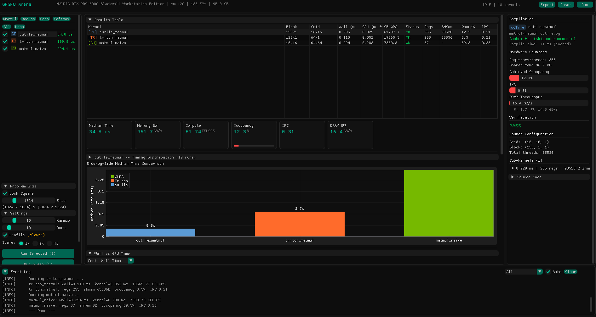
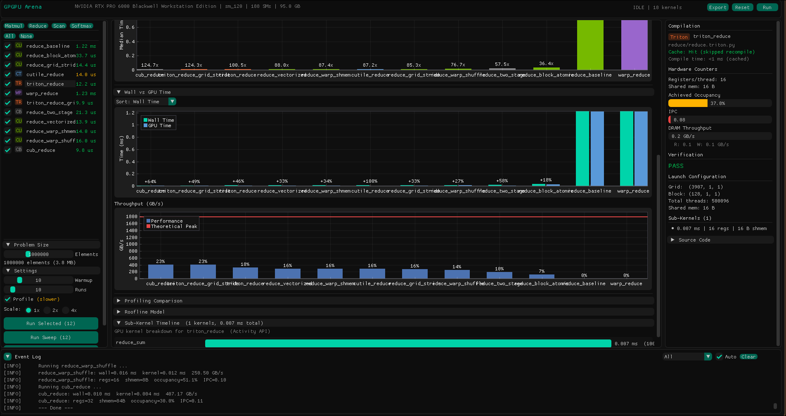
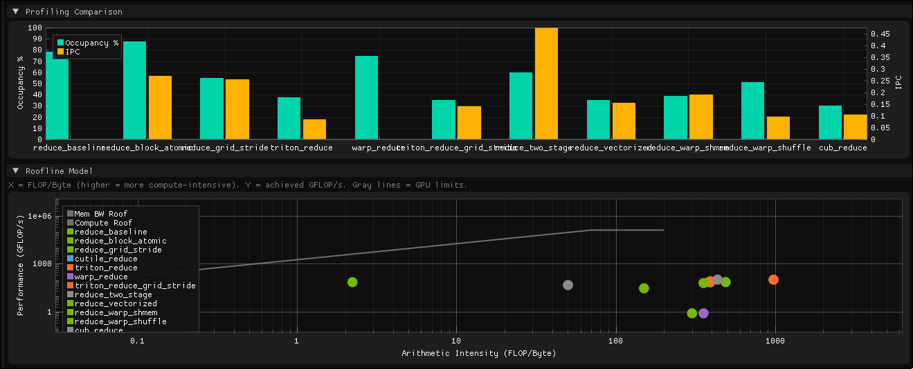
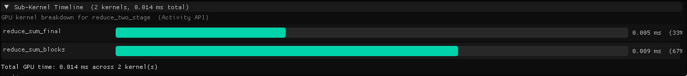

# GPGPU Arena

Write the same GPU kernel in CUDA C++, Triton, cuTile or Warp, then run them
side by side on the same inputs with the same measurement code.



## Quick start

You need Docker with the [NVIDIA Container Toolkit](https://docs.nvidia.com/datacenter/cloud-native/container-toolkit/install-guide.html).

```bash
xhost +local:docker
docker compose up gui
```

## Headless mode

For scripts and CI. JSON goes to stdout and logging is turned off, so you can
pipe the output straight into other tools.

```bash
./arena --list                                    # kernels and categories
./arena --run reduce -p n=4000000 --runs 20       # one category
./arena --run cub_reduce -p n=1000000 --profile   # one kernel, with counters
./arena --run all --energy -o results.csv --format csv
```

Sizes, input distributions and seeds take comma-separated lists, and every
combination runs, each result recording which one it was. Shapes that are not
a grid are listed with `--shape`:

```bash
./arena --run reduce_vectorized -p n=1000003,67108864 --dist uniform,adversarial --seed 1,2
./arena --run softmax --shape rows=64,cols=1024 --shape rows=16384,cols=4096
```

Kernels described by a JSON manifest (see Agents and PGAIO) need no C++
descriptor. `--manifest k.json` runs one; `--open <dir>` loads every manifest
under a folder as kernels, for `--list` and category runs.

The GUI lists one folder's kernels at a time: `kernels/` by default, or the
folder given with `--open`, so `docker compose run --rm gui --gui --open
pgaio/runs/scan-1` shows that run's baseline and candidates (named
`scan-1/006-m1`, with the hypothesis and score on hover), and `--open
pgaio/runs` shows every run. The Open button switches folders and lists the
PGAIO runs. A native build usually lacks Triton, cuTile or Warp; their kernels
are greyed out there, and the Docker GUI runs them.

Three commands describe a kernel without running it:

```bash
./arena --inspect reduce_vectorized    # JSON: source, descriptor, registers, spills, SASS mix
./arena --sass triton_reduce           # SASS of the entry point
./arena --ptx reduce_vectorized        # PTX, for CUDA and Triton
```

`--source-override <file>` compiles a different source into an existing
kernel's slot and runs it with that slot's descriptor, launch config and
verification. The file has to keep the slot's entry point and parameters.
This is how a modified kernel gets measured without writing a descriptor or
rebuilding.

Exit codes let a caller branch without parsing the output:

| Code | Meaning |
| --- | --- |
| 0 | Everything ran and verified |
| 1 | Ran, but something failed verification |
| 2 | Something errored (compile, launch, or device) |
| 3 | Bad arguments |

The JSON also records the device, driver, toolkit and clocks, so a saved
result file says what produced it. `./arena --help` lists every flag.

Build with `-DBUILD_GUI=OFF` if you want a headless binary with no GLFW or
OpenGL dependency.

## Tuning

Two things can be swept: problem size and kernel config.

Problem size is a range. `--sweep-min`, `--sweep-max` and `--sweep-factor` set
it. Leave them at zero and each category uses its own defaults.

Kernel config works differently on the two sides. A hand-written CUDA kernel
can just be relaunched at a different block size. A DSL kernel cannot, because
the block size is baked into the cubin: cuTile emits a `.reqntid` the launch
has to match exactly, and Triton derives the block from `num_warps` at compile
time. Changing those means recompiling. For a DSL, sweeping the block size is
autotuning.

`--sweep-block` handles both. CUDA kernels run at every block size they
declare, DSL kernels run at every compile config they declare, and each config
gets its own cached cubin. Use `--block <n>` or `--define KEY=n` to pin one.

Best against worst config over `reduce` at n=4M:

| kernel | best config | spread |
| --- | --- | --- |
| `reduce_block_atomic` | block=64 | 5.1x |
| `reduce_grid_stride` | block=128 | 3.9x |
| `reduce_warp_shuffle` | block=512 | 3.6x |
| `reduce_warp_shmem` | block=256 | 3.0x |
| `triton_reduce` | BLOCK_SIZE=1024, num_warps=8 | 2.2x |
| `cutile_reduce` | TILE_SIZE=1024 | 1.6x |
| `triton_reduce_grid_stride` | BLOCK_SIZE=4096, num_warps=2 | 1.6x |

The last row is why this matters. Tuned, that kernel runs in 0.0084 ms and
beats `cub_reduce` at 0.0133 and every hand-written CUDA kernel here. These
figures were taken with a warm L2 (see Measurement); the 16 MB input fits in
cache. At the
value written in its source file it runs in 0.0131. Without this axis you are
comparing how well each kernel was guessed at, not what the language can do.

## Measurement

Timing comes in three tiers. They measure different things, so never add them
together or compare one against another.

| Tier | Fields | What it is |
| --- | --- | --- |
| Per invocation | `op_ms`, `gpu_ms`, `overhead_ms`, `launch_count` | Whole operation against summed SASS time. The gap is launch latency and sync between kernels. |
| Per process | `module_load_ms`, `first_launch_ms` | Cold start, paid once per process. |
| Build | `compile_ms`, `import_ms`, `invoke_ms` | One time, cached to disk. `compile_ms` is the DSL compiler itself, separate from Python startup. |

GFLOPS and GB/s divide by `op_ms`. Hardware counters divide by `gpu_ms`.

`op_ms` is a median. Microsecond kernels' event timings cluster near
multiples of about 2 µs on some GPUs, so results also carry `op_ms_trimmed`,
the mean of the middle half of the runs, which moves smoothly where the
median steps. Each run also reports two floors in `environment`:
`launch_floor_ms` (an empty kernel launch, about 2.2 µs on an RTX PRO 6000)
and `roundtrip_floor_ms` (a launch plus one cold DRAM read and one write,
about 4.1 µs), the least a kernel that reads its input from memory can take.

By default the timed loop runs with whatever the previous launch left in L2.
A working set smaller than L2 (128 MB on an RTX PRO 6000) is then served from
cache after the first run, and the number describes L2 rather than DRAM.
`--l2 cold` overwrites a buffer twice the size of L2 before every timed launch,
outside the timed interval. On `reduce_vectorized` at n=4M the GPU time goes
from 0.0098 ms warm to 0.0217 ms cold. Each result records which mode it ran
in, under `input.cold_l2`.

Warmup runs until the timings settle instead of a fixed count. It compares the
median of one window against the previous one, because a clock that is still
boosting drifts steadily and a variance test would call that stable. Results
carry `warmup_converged` so you can tell when a number came off an unsettled
clock. Use `--warmup <n>` if you want a fixed count instead.

Energy uses NVML over a sustained back-to-back window, because NVML updates
much more slowly than a single kernel runs. It reads whole-board power, so
`mj_per_op` is an upper bound on what a kernel actually costs. The runner logs
how busy the device was and warns when the loop was launch-bound.

## Numerics

Kernels report measured error, not just pass or fail. Every category checks
against a CPU reference summed in `double` and reports max and mean relative
error next to the tolerance it was judged against.

Verification covers the whole output, so a kernel cannot pass by computing
only the parts that get checked. Reduce, softmax and layernorm check every
value, scan every element, and matmul one element in every output tile plus
the full last row and column, at positions that change with the seed. Scan
and matmul measure each error against the sum of the magnitudes that went
into it, the scale summation error grows with, because a mixed-sign prefix or
dot product can land near zero where a plain relative error fails a correct
kernel. Layernorm measures it against |gamma| (|x| + mean|x|) rstd + |beta|
for the same reason, and its inputs include near-constant rows where eps
decides the answer.

There are two errors because they answer different questions.

Arithmetic error is measured against the inputs the kernel actually received,
already rounded to its storage type. That part is the kernel's own doing, so
pass and fail are judged on it, and it is comparable within one dtype.

Total error is measured against the original fp32 data, so it includes what a
narrower storage type cost before the kernel ran. That is the number you can
compare across dtypes, and it is what the results table shows.

For an fp32 kernel the two are the same. For `reduce_fp16_accum_fp32` at 64M
they are `7.3e-07` and `6.6e-05`. Its summation is as clean as a good fp32
kernel, and storing the inputs in half still costs two orders of magnitude.

Tolerance comes from the mantissa of the output type, scaled by the square
root of the accumulation length, since summing more values genuinely loses
precision. This separates a kernel that is imprecise from one that is broken.
`reduce_baseline` over 64M ones reports `7.4e-01`, which is an fp32
accumulator saturating at 2^24, not a bug.

Pick the input data with `--dist`:

| Distribution | Use |
| --- | --- |
| `ones` | Quick sanity check. Hides ordering bugs, every reduce scores exactly zero. |
| `uniform` | Default. Mixed signs, so accumulation order starts to matter. |
| `normal` | Occasional large values. |
| `adversarial` | Mixed magnitudes, denormals and exact zeros. |

`--seed` makes a run repeatable. The CPU reference is rebuilt from the same
numbers the GPU saw.

A kernel declares its input and output types separately, because mixed
precision is normal: `reduce_fp16_accum_fp32` reads fp16 and writes fp32.
There is no accumulator type, since a kernel can have several at different
precisions. The framework only models what crosses the buffer boundary.

Tolerance follows the output type. A kernel cannot be more precise than the
type it writes into, so that is what it is held to. A kernel whose internals
are coarser will miss it, which is the point. `reduce_fp16_accum_fp16` writes
fp32 but sums in half, and fails.

Dtype is part of a kernel's identity rather than a switch, so the fp16
variants are separate rows in the same `reduce` table. At n=4M:

| kernel | in > out | error | |
| --- | --- | --- | --- |
| `reduce_fp16_accum_fp16` | fp16 > fp32 | 7.8e-03 | sums in half, fails |
| `reduce_fp16_accum_fp32` | fp16 > fp32 | 1.5e-07 | sums in float |
| `reduce_fp16_out_fp16` | fp16 > fp16 | 5.8e-04 | clean sum, half output |

Supported types are fp32, fp16, bf16, both OCP fp8 variants (e4m3 and e5m2)
and fp4 (e2m1). Buffers are sized in bits, so fp4 packs two values per byte.
Tolerance has a floor of half an ulp of the output type, so a kernel is never
asked to be more accurate than the type it writes into.

NVFP4 is not usable yet. The element type exists, but the format is fp4 values
with a shared e4m3 scale every 16 elements, and the base descriptors do not
allocate a second buffer for those scales. `dtype_is_block_scaled()` flags it
so nothing treats it as a plain narrow type.

Sources live in `kernels/<category>/<input dtype>/`. The folder is named after
what the kernel reads, since that is what shapes the code: reading `__half*`
instead of `float*` changes the signature and the load path, while the output
type is one store at the end. Variants that share an input type but differ in
output go in the same file, which is why all three above are in
`kernels/reduce/fp16/accum.cu`.

## Known issues

Counter values describe a warm launch. The counter pass runs twelve launches
back to back and keeps the smallest DRAM figure. Instrumentation re-cools L2
every few launches, so any single one is warm or cold depending on where it
lands, and since instrumentation can only add DRAM traffic the minimum is the
closest estimate of the untouched timed loop.

This is a different question from the one Nsight Compute answers by default.
For an 86 MB working set on a 128 MB L2, a cold launch moves 86 MB from DRAM
and a warm one moves 0.05 MB. Both are correct measurements of different
things. Expect `dram_read_bytes` to sit far below an `ncu` figure when the data
fits in cache, and to agree when it does not: at a 400 MB working set this
reports 400.1 MB against Nsight's 400.5.

The compile cache is keyed on a hash of the source, the DSL's shared base
module, the compiler version and flags, the GPU arch, and the compile-time
defines. Editing any of them rebuilds; nothing else does.

## How it works

```
Source (.cu / .triton.py / .cutile.py)
    |
    v
Runtime compiler (nvcc / Triton / cuTile)  ->  .cubin (cached)
    |
    v
cuModuleLoad  ->  cuLaunchKernel  ->  benchmark and profile
```

Everything compiles to a cubin, final SASS, at runtime on first use. Cubins are
cached on disk and later runs skip compilation. Edit a kernel source, run
again, and only that kernel rebuilds. CUDA builds carry `-lineinfo`, which has
no runtime cost and lets SASS be mapped back to source lines.



## Adding a kernel

Each kernel is two files: the GPU source, and a C++ descriptor holding its
metadata.

CUDA C++:

```
kernels/reduce/my_kernel.cu     # extern "C" __global__ kernel
kernels/reduce/my_kernel.cpp    # name, launch config, args, verification
```

Triton:

```
kernels/reduce/my_kernel.triton.py    # @jit kernel plus triton_base.main()
kernels/reduce/my_kernel.triton.cpp   # descriptor using compile_result_
```

cuTile:

```
kernels/reduce/my_kernel.cutile.py    # @ct.kernel plus cutile_base.main()
kernels/reduce/my_kernel.cutile.cpp   # descriptor plus param buffer
```

The descriptor sets `needs_compilation() = true` and `source_path()`. Compiling,
loading, benchmarking and verifying happen automatically.

To try a kernel without writing a descriptor or rebuilding, give it a JSON
manifest instead and run `./arena --manifest k.json`. The format, with a
verified example for each DSL, is in `skills/arena-optimize/manifests.md`.

A CUDA source can also choose its own launch shape with a comment such as
`// arena: BLOCK_M=128 BLOCK_N=128 THREADS=256`. Upper-case keys land in the
compile result's constants, the same place a Triton kernel's constexprs go,
and descriptors like `matmul_tiled` and `scan_multiblock` build their grid
from them.

## Layout

Compiler backends in `src/arena/compilers/`, one per DSL. `CudaBackend` runs
nvcc. `TritonBackend`, `CuTileBackend` and `WarpBackend` share `PythonBackend`,
which runs the kernel's Python file; that file writes a cubin plus JSON
metadata. `sass.cpp` parses `cuobjdump` output for `--inspect`.

`KernelCompiler` picks a backend by file extension and owns the two-level
cache (memory, then disk keyed on a content fingerprint), output naming and
compile timing.

The kernel loader in `src/arena/device/` loads cubins with `cuModuleLoad` and
launches with `cuLaunchKernel`.

Measurement code in `src/arena/measurement/` covers warmup, timing, CUPTI
profiling and NVML energy.

`Runner` ties it together: compile, warm up, benchmark, profile, verify.

## Profiling

Occupancy and IPC side by side, plus arithmetic intensity against performance
on a roofline:



The sub-kernel timeline, from the Activity API, splits multi-launch kernels
into their individual GPU invocations:



Counters need GPU performance counter access:

```bash
echo "options nvidia NVreg_RestrictProfilingToAdminUsers=0" | sudo tee -a /etc/modprobe.d/nvidia-profiler.conf
sudo update-initramfs -u
sudo reboot
```

Without it benchmarking still works and only the profiling pass fails.

The range profiler reports one range per launch. For a kernel that launches
more than once per operation, such as `reduce_two_stage` or CUB, ranges are
grouped back into whole operations before the least-traffic one is picked,
with bytes summed across launches and occupancy and IPC taken from the
dominant launch.

## Agents and PGAIO

`skills/` holds instructions for coding agents: running the CLI, reading
results, inspecting SASS and PTX, adding kernels, and running a profile and
benchmark guided optimization (PGAIO) loop. Nothing needs installing. Claude
Code finds them through `.claude/skills` and Codex through `.agents/skills`,
both links to `skills/`, and `AGENTS.md` lists them.

| Skill | What it covers |
| --- | --- |
| `arena-cli` | Running kernels, the JSON schema, exit codes, how to compare fairly |
| `arena-inspect` | `--inspect`, `--sass`, `--ptx`, counters and the roofline, `--source-override` |
| `arena-add-kernel` | Files, descriptors, ABI, promoting a candidate to a kernel |
| `arena-optimize` | The PGAIO loop |

`tools/pgaio.py` is the environment for that loop. A run targets a problem
(reduce, scan, softmax, layernorm, matmul or attention) at a size regime, and the agent
writes as many candidates as it wants, in any DSL:

```bash
python3 tools/pgaio.py init --category softmax --sizes all --scratch-policy declared   # no budget, target 100% of SOL
python3 tools/pgaio.py check <run> work/v3.json                  # free: launch plan at every shape
python3 tools/pgaio.py sass <run> work/v3.json --show LDG,BAR   # free: how a draft compiled
python3 tools/pgaio.py eval <run> work/v3.json --hypothesis "warp-shuffle reduction"
python3 tools/pgaio.py profile <run> 7                          # free: Nsight Compute on an evaluated iteration
python3 tools/pgaio.py ab <run> 7 9                             # free: alternating A/B timing with a CI
python3 tools/pgaio.py compare <run> 2 7                        # free, also against ref:cublas
python3 tools/pgaio.py reference <run> --lib cublas             # free: matmul's library ceiling
python3 tools/pgaio.py skip-dsl <run> cutile --reason "..." --evidence "..."
python3 tools/pgaio.py status <run>
python3 tools/pgaio.py learn <run> --insight "..." --evidence "..."
python3 tools/pgaio.py api cutile load                           # free: a DSL's API
python3 tools/pgaio.py report --html progress.html
```

With no budget a run goes until the target, a plateau, or until it is
stopped. A plateau is 10 evals without a real gain, after every DSL had 3
evals or was marked a dead end with `skip-dsl`. In runs started now a gain
must beat the best by more than 0.5 points and by more than the two scores'
confidence intervals, or be shown faster by `ab`; older runs keep the plain
0.5 point rule. Asking an agent only needs the problem, for example
"optimize softmax for small inputs, any DSL", and the skill fills in the
rest.

`profile` runs Nsight Compute on arena for an iteration that passed eval, or
on the library reference, and saves stall reasons, pipe use, bank conflicts
and the instructions carrying the most stalls under `profiles/` in the run.
Its durations come from a locked base clock with replay and are never a
score. `reference --lib cublas` times `matmul_cublas` (plain FP32, no TF32)
with eval's settings, so every matmul candidate is also shown as a
percentage of cuBLAS. References never become the best and do not count.

A candidate is a kernel plus a small JSON manifest saying how to launch it:
grid and block as expressions such as `cdiv(rows, ROWS_PER_PROGRAM)`, and
arguments from a fixed vocabulary (the category's buffers and sizes, scratch
buffers, and each DSL's argument format). Launches can carry a `when`
condition and their own `source`, so one candidate can dispatch small and
large inputs to different kernels, chain several Triton kernels, or mix
DSLs. The manifest is data, not code: it chooses how a kernel is launched
but never touches the data, the reference, the verification or the byte
counts SOL is computed from. Arena checks every argument against the
compiled function's real parameter sizes and refuses a mismatch.

`--sizes small|large|all` (default all) picks the timed shapes, from a few KB
up to several times L2. Each shape is scored against the slowest of three
floors: the ideal bytes at peak DRAM bandwidth, the FLOPs at peak FP32, and
the round-trip latency floor. The run's score is the geometric mean across
shapes, so a kernel cannot hide a weak size, and every observation prints the
per-shape table.

Each `eval` gates the candidate on held-out sizes, distributions and seeds,
times it with `--l2 cold` and 100 runs per shape, diffs its SASS against the
best so far, and prints a short diagnosis. Verification uses inputs
regenerated from a seed the kernel never saw and covers the whole output, so
a kernel that caches, precomputes or skips work fails. The harness is hashed
before and after, so a candidate that edits it is rejected; `rehash` lets a
maintainer accept a deliberate harness change mid-run, and records it in the
journal. Every eval counts against its DSL's budget (candidates mixing DSLs
count as `mixed`); looking at SASS does not. `journal.md` and `progress.html`
in the run folder update after every eval.

The first loops, run on every category at all sizes with Claude Opus 5.5 on
an RTX PRO 6000: reduce 0.7% to 75.1%, scan 1.1% to 64.7% (CUDA plus Triton
dispatch), softmax 57.5% to 74.9%, matmul 8.1% to 29.6% (40.7% of FP32 peak
at 4096^3), attention 2.1% to 22.9% (a fused online-softmax kernel at ~31%
of FP32 peak for long sequences). A later FP32 matmul run against cuBLAS
went from 4.8% to 47.4%, about 95% of cuBLAS on the same board. What they
taught is in
`pgaio/learnings.jsonl` and the optimize skill's `playbook.md`.

Run directories go to `pgaio/runs/` (ignored by git). Insights recorded with
`pgaio.py learn` go to `pgaio/learnings.jsonl` and are shown at the start of
later runs.

### Measurement changes

Some later additions change what a measurement includes. Each is reporting
only, opt-in, or applies only to runs started after it, so older runs stay
readable and comparable:

| Change | Effect on measurements |
| --- | --- |
| Score CI and per-shape spread | Reporting only, computed from the timings eval already takes. |
| `init --counters full` (the default for new runs) | More counter replay passes, so evals take longer. Timing runs separately and is unaffected. |
| Clock and power sampling | A host thread polls NVML every 2 ms during the timed runs. It issues no GPU work and timing uses CUDA events, so GPU times are unaffected; on a busy host it shares the CPU with the launching thread. NVML refreshes the clock reading about every 500 ms, so short windows report one value. |
| `init --lock-clocks <MHz\|auto>` | Opt-in. Steadier rankings, lower absolute numbers than boost. Needs root (and `SYS_ADMIN` in Docker); falls back to unlocked with a warning, recorded in the run. |
| `init --scratch-policy declared` | Opt-in. Zeroing scratch marked `"zero": true` moves inside the timed op, so `op_ms` includes the memset; other scratch is filled with `0xFF`. The default `legacy` keeps the old behaviour. |
| `matmul_cublas` | A new reference kernel. It never becomes a run's best and does not count as an iteration. |
| Plateau rule 2 | New runs only; runs without the setting keep rule 1. |

## Tests

```bash
ctest --test-dir build --output-on-failure        # C++: cache keys, SASS parsing, CLI args, numerics
python3 -m unittest discover -s tools/tests       # PGAIO scoring, gating, reports, skills checks
python3 tools/check_skills.py                     # skill frontmatter, paths named in skills
```

None of these need a GPU. CI runs them on every push and pull request, builds
with and without the GUI, and has an opt-in job for a self-hosted GPU runner
that runs the reduce category on held-out inputs and a PGAIO baseline.
